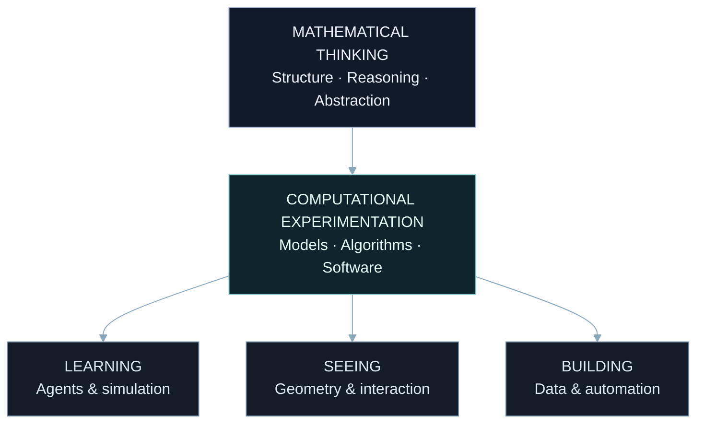

<!-- PAUL ZIEGON / THE MATHEMATICAL OBSERVATORY -->
<!-- Self-contained: no image assets, external widgets, custom CSS or scripts. -->

 

B O N N &nbsp; / &nbsp; G E R M A N Y

<h1>PAUL ZIEGON</h1>

M A T H E M A T I C S &nbsp; × &nbsp; M A C H I N E &nbsp; L E A R N I N G

 
 

### Between proof & possibility.

Mathematical thinking. Intelligent systems. Creative engineering.

 

**[The explorations](#02--the-explorations)** &nbsp; · &nbsp; **[The instruments](#03--the-instruments)** &nbsp; · &nbsp; **[The conversation](#06--the-conversation)**

 

---

THE MATHEMATICAL OBSERVATORY &nbsp; / &nbsp; A PERSONAL FIELD NOTE

 

## 01 / The point of departure

I'm **Paul Ziegon**, a **Mathematics & Computer Science student at the University of Bonn**.

I'm interested in what happens when an abstract idea becomes something you can investigate: an agent learning to drive, a mathematical structure you can explore, a model you can question or a system that turns repeated work into a deliberate process.

My interests connect **machine learning, reinforcement learning, quantitative modeling and interactive computing**. I enjoy working through difficult problems, understanding their mathematical foundations and translating that understanding into software.

> **Curiosity drives the question.**  
> Mathematics builds the foundation.  
> Engineering brings the idea to life.

 

 

## 02 / The explorations

FOUR DIRECTIONS &nbsp; / &nbsp; ONE UNDERLYING CURIOSITY

 

### Ⅰ &nbsp; Learning the racing line

**Autonomous Racing Intelligence**

$$
\underbrace{s_t}_{\text{observe}}
\;\xrightarrow{\;\pi(a\mid s)\;}\;
\underbrace{a_t}_{\text{act}}
\;\longrightarrow\;
\underbrace{s_{t+1}}_{\text{observe again}}
$$

An environment, an observation, a decision. Then another.

I'm exploring autonomous racing agents capable of learning driving behavior through **reinforcement learning**, with an interest in the relationship between mathematical models, simulation and autonomous decision-making.

**Focus**  
Deep reinforcement learning · Simulation environments · Autonomous decisions · Model optimization

 

---

 

### Ⅱ &nbsp; Thinking in uncertainty

**Quantitative Intelligence**

$$
\mathbb{E}[X]
\qquad \operatorname{Var}(X)
\qquad \mathbb{P}(A\mid B)
$$

Patterns invite a model. Uncertainty invites a better question.

I'm exploring **algorithmic trading concepts, quantitative modeling and data analysis** — connecting mathematical reasoning with computational approaches to financial markets and automated workflows.

**Focus**  
Quantitative models · Data-driven strategies · Algorithmic approaches · Intelligent automation

 

---

 

### Ⅲ &nbsp; Giving abstraction a shape

**Interactive Mathematics**

$$
\underbrace{x+iy}_{\text{symbol}}
\;\longleftrightarrow\;
\underbrace{(x,y)}_{\text{geometry}}
$$

A formula can describe a structure. Interaction can make it tangible.

I'm building visual experiences that transform mathematical ideas into **intuitive, interactive environments**, combining mathematical visualization with creative web engineering.

**Focus**  
WebGL & Canvas · React · Interactive geometry · Visual computing

 

---

 

### Ⅳ &nbsp; Turning repetition into a system

**Intelligent Automation**

$$
x
\;\xrightarrow{\;f\;}\;
f(x)
\;\xrightarrow{\;g\;}\;
(g\circ f)(x)
$$

Small operations. Thoughtful composition. Useful systems.

I'm exploring custom programs and automated workflows for **repetitive and computationally complex tasks**, with an emphasis on algorithmic problem solving and making separate pieces of software work together.

**Focus**  
Python automation · Data processing · Software integration · Algorithms

 

The mathematical sketches illustrate each direction; they do not represent measured project results.

 
 

**[Enter the repository collection ↗](https://github.com/paulziegon?tab=repositories)**

 

## 03 / The instruments

A WORKING SET FOR MOVING BETWEEN THEORY AND IMPLEMENTATION

 

**Write the logic.**  
`Python` &nbsp; `C++`

**Build the experience.**  
`React` &nbsp; `Next.js` &nbsp; `Tailwind CSS` &nbsp; `WebGL` &nbsp; `Canvas`

**Work with models and data.**  
`PyTorch` &nbsp; `MySQL`

**Support the system.**  
`Docker` &nbsp; `Linux` &nbsp; `Git` &nbsp; `GitHub`

**Organize the work.**  
`VS Code` &nbsp; `Notion`

 

### Still learning. Deliberately.

**01** &nbsp; Deep Reinforcement Learning  
**02** &nbsp; Advanced Mathematics  
**03** &nbsp; GPU Computing  
**04** &nbsp; Algorithm Design

The questions that keep me interested emerge where mathematical theory meets computational experimentation.

 

## 04 / The method

 

**Understand the mathematics.**

Question the assumptions.

Build the system.

**Test the limits.**

 

THINK DEEPLY. &nbsp; BUILD BOLDLY. &nbsp; IMPROVE CONTINUOUSLY.

 

## 05 / Outside the coordinate system

### A different kind of engineering.

One of my most memorable hands-on projects was transforming a **2002 Mitsubishi Pajero into a camper tourer** while in **Victoria, Australia**.

Different materials. The same instinct: understand the constraints, think creatively and make something work in the real world.

Problem solving doesn't end at the terminal.

 

## 06 / The conversation

Interested in **mathematics, AI, machine learning, engineering or ambitious open-source projects**?

I'd be happy to connect and exchange ideas.

 

**[Write me an email ↗](mailto:paul.ziegon.07@outlook.de)**

[GitHub](https://github.com/paulziegon) &nbsp; / &nbsp; [Instagram](https://instagram.com/paul_ziegon) &nbsp; / &nbsp; [TikTok](https://tiktok.com/@contourxplorer)

 
 

---

 

### Every great system starts with a question.

 

PAUL ZIEGON

THE MATHEMATICAL OBSERVATORY &nbsp; / &nbsp; BUILT WITH CURIOSITY AND CODE

 

